[Tab Tamer on GitHub](https://github.com/j-ctang/tab-tamer)

[▶ Listen to hello mono | visualizer on YouTube](https://www.youtube.com/watch?v=4deDga_hTig)

## Featured project

[View Jev Prune on GitHub](https://github.com/j-ctang/claude-code-jev-prune) · [Install Jev Prune](https://github.com/j-ctang/claude-code-jev-prune#install)

## What I’m exploring now

