[▶ Listen to hello mono | visualizer on YouTube](https://www.youtube.com/watch?v=4deDga_hTig)

## About me

I’m Justin. I like building small tools that take friction out of everyday work. When I’m deep in a coding session, I want the tools I use to help me keep my train of thought.

I also like experimenting with how work feels on screen. This little desktop is one of those experiments. I wanted my profile to feel like sitting down and showing you what I’ve been working on.

## Featured project

### [Jev Prune for Claude Code](https://github.com/j-ctang/claude-code-jev-prune)

Long coding sessions pile up tool output you may never need again. Jev Prune clears stale tool output from the session while keeping the visible conversation intact, so you can still go back and read how you got there.

## What I’m exploring now

I’m prototyping a tangerine tree that grows from a seed into a canopy of zeros and ones. I want the growth to feel continuous, from the first branch to the moment the oranges appear.
